# UnBSense — detecção de sinais de comportamento depressivo em tweets em português (F1 ≈ 80%)

[](LICENSE)
[](https://doi.org/10.5753/reic.2024.3430)

> **Resultado:** Gradient Boosting atinge **F1 = 81,6% (pré-pandemia) e 79,9% (pandemia)** no conjunto de teste (média 80,75%), contra **73,7% / 74,9%** da Regressão Logística (baseline, validação), em 71.232 e 70.370 usuários do Twitter. Os 5 atributos novos propostos **não melhoraram** o modelo (ΔF1 ≤ 0,4 p.p.). Resultados reportados como ponto único, sem IC (ver [Limitações](#️-limitações)).

Projeto de Iniciação Científica (PIBIC/CNPq 2021-2022, Universidade de Brasília) e Trabalho de Conclusão de Curso. Estende De Choudhury et al. (2013) e Coppersmith et al. (2014) para tweets em português do Brasil.

- 📄 Artigo: Freitas, Ladeira & Caetano (2024). *Desenvolvimento de Ferramenta de Análise de Sentimentos para Identificação de Possíveis Sinais de Comportamento Depressivo na Rede Social Twitter*. REIC, 22, 91–100. [doi:10.5753/reic.2024.3430](https://doi.org/10.5753/reic.2024.3430)
- 🎓 Monografia: Freitas (2022). *Abordagem baseada em aprendizagem de máquina para identificar sinais comportamento de depressão na rede social Twitter utilizando conteúdos das postagens e atividades*. [bdm.unb.br/handle/10483/33530](https://bdm.unb.br/handle/10483/33530)

## 🎯 Problema

- **Quem decide o quê:** pesquisadores e, futuramente, uma ferramenta de análise de sentimentos que oriente o usuário a buscar ajuda profissional ao identificar sinais de padrão depressivo nas próprias postagens. **Não é um instrumento de diagnóstico.**
- **Custo dos erros:** falso negativo = sinal real não detectado; falso positivo = alarme indevido. O trabalho usa **F1-score** como métrica-alvo (média harmônica de precisão e recall), sem ponderar explicitamente os custos de FP e FN.
- **Unidade de predição:** 1 linha por usuário, com 60 atributos (15 atributos × 4 estatísticas da série temporal diária: média, variância, média móvel ponderada e entropia) e rótulo `depressão` / `controle`, por período.

### Perguntas de pesquisa

1. Quais classificadores detectam melhor sinais de comportamento depressivo em tweets em português?
2. Cinco novos atributos (caracteres orientais, emojis, mídia, links e curtidas) melhoram o modelo baseado nos 10 atributos de De Choudhury?
3. A pandemia de COVID-19 alterou a ocorrência de autodeclarações de depressão no Twitter?

## 🗂️ Dados

| Item | Pré-pandemia | Pandemia |
|---|---|---|
| Período | 01/01/2018 – 31/12/2019 | 01/01/2020 – 31/12/2021 |
| Usuários | 71.232 | 70.370 |
| Depressão / Controle | 37.985 / 33.247 | 36.801 / 33.569 |
| Prevalência de depressão | 53,3% | 52,3% |
| Coleta | `snscrape` (tweets públicos, anonimizados) | idem |

- **Rótulo por autodeclaração:** classe *depressão* = usuários que escreveram frases como "tenho depressão", "fui diagnosticado com depressão"; classe *controle* = usuários sem essas frases (busca com operador de negação). O rótulo mede **autodeclaração pública**, não diagnóstico clínico.
- **Qualidade:** removidos usuários com > 300 tweets em um dia ou < 30 tweets na conta.
- **Léxicos auxiliares:** ANEW-BR (Kristensen et al., 2011) para valência/ativação/termos depressivos e uma base própria de antidepressivos usados no Brasil (em [datasets/baseUtilitarias/](datasets/baseUtilitarias/)).
- **Bases geradas:** [datasets/twitterbase_pre-pandemia.csv](datasets/twitterbase_pre-pandemia.csv) e [datasets/twitterbase_pandemia.csv](datasets/twitterbase_pandemia.csv).
- **Datasheet:** ainda não escrito (pendente).

| Pré-pandemia (2018–2019) | Pandemia (2020–2021) |
|---|---|
| 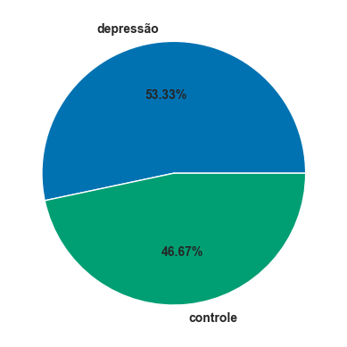 | 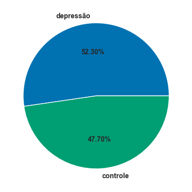 |

### Atributos

| # | Atributo | Origem |
|---|---|---|
| 1 | Volume de tweets | De Choudhury |
| 2 | Índice de insônia (tweets noturnos 21h–6h ÷ diurnos) | De Choudhury |
| 3–5 | Estilo linguístico: pronomes de 1ª, 2ª e 3ª pessoa | De Choudhury |
| 6–7 | Valência e ativação emocional (ANEW-BR) | De Choudhury |
| 8 | Termos depressivos (palavras com valência < 4) | De Choudhury |
| 9 | Grafo social (respostas de seguidores) | De Choudhury |
| 10 | Menções a antidepressivos | De Choudhury |
| 11 | Caracteres orientais (CJK) | **novo** |
| 12 | Emojis | **novo** |
| 13 | Frequência de links | **novo** |
| 14 | Mídia (fotos, vídeos, gifs) | **novo** |
| 15 | Curtidas recebidas | **novo** |

## 🧪 Metodologia

Baseada no CRISP-DM, em 10 etapas:

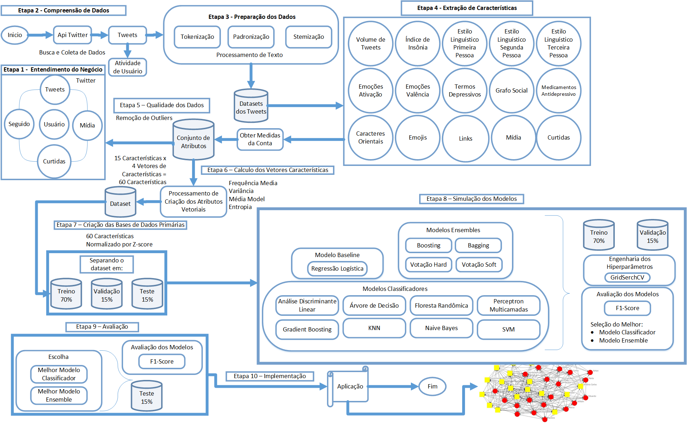

1. Coleta por autodeclaração (`snscrape`) → pré-processamento (tokenização, padronização, stemização) → extração dos 15 atributos.
2. Séries temporais diárias → 4 estatísticas por atributo → 60 atributos por usuário.
3. Normalização *Z-Score* e seleção de 30 atributos por matriz de correlação de Pearson (baixa correlação entre si).
4. Divisão aleatória em treino (70%) / validação (15%) / teste (15%); hiperparâmetros por `GridSearchCV`; validação cruzada de 10 *folds*.
5. 13 classificadores comparados com os 10 atributos originais → os 2 melhores (um clássico e um *ensemble*) são usados para testar os 5 atributos novos, um a um → avaliação final no teste.

## 📊 Resultados

Protocolo: *split* 70/15/15 aleatório por usuário, CV 10-*folds* + `GridSearchCV` no treino/validação, teste uma única vez. Valores em %, **sem intervalo de confiança** (os trabalhos originais reportam apenas ponto único).

### 1. Seleção de modelos (validação, 10 atributos de De Choudhury)

| Modelo | F1 pré-pandemia | F1 pandemia |
|---|---|---|
| Baseline: Regressão Logística | 73,7 | 74,9 |
| Perceptron Multicamadas (MLP) | 81,0 | 80,4 |
| Árvore de Decisão | 80,0 | 79,4 |
| Floresta Randômica | 81,8 | 81,2 |
| Boosting | 82,0 | 81,3 |
| **Gradient Boosting (GB)** | **82,2** | **81,5** |
| Naive Bayes | 58,7 | 58,9 |

Demais modelos (KNN, SVM, LDA, Bagging, Votação Hard/Soft) ficaram entre 74,8 e 81,3. Tabela completa em [Artigo, Tab. 2](3430-Texto%20do%20artigo-22196-1-10-20240829.pdf) e [Monografia, Tab. 4.1](2022_LuanMendesGoncalvesFreitas.pdf).

> ⚠️ A Regressão Logística tem recall = 100% e acurácia = precisão (58,3% / 59,9%): ela praticamente prevê tudo como "depressão". Seu F1 de ~74% é, portanto, um piso trivial para uma classe majoritária, e o ganho real dos melhores modelos sobre ele é de ~7–8 p.p. de F1.

### 2. Os 5 atributos novos ajudam? Não.

F1 (validação) do GB com os 10 atributos de De Choudhury + cada atributo novo:

| Período | Só 10 originais | + Caract. orientais | + Emojis | + Links | + Mídia | + Curtidas |
|---|---|---|---|---|---|---|
| Pré-pandemia | 82,2 | 82,2 | 82,1 | 82,0 | 82,2 | 82,1 |
| Pandemia | 81,5 | 81,5 | 81,8 | 81,5 | 81,4 | 81,5 |

A maior variação é +0,3 p.p. (emojis, pandemia), dentro do que se esperaria de ruído entre execuções; nenhum teste de significância foi aplicado. O MLP segue o mesmo padrão. Os 5 atributos foram **removidos** do teste final.

### 3. Teste final (10 atributos de De Choudhury)

| Modelo | Acurácia pré | F1 pré | Acurácia pand. | F1 pand. | **F1 médio** |
|---|---|---|---|---|---|
| Gradient Boosting | 76,8 | 81,6 | 74,2 | 79,9 | **80,75** |
| Perceptron Multicamadas | 75,8 | 80,6 | 74,2 | 79,4 | **80,0** |

Matrizes de confusão no teste (1ª linha: pré-pandemia; 2ª linha: pandemia):

| Gradient Boosting | Perceptron Multicamadas |
|---|---|
| 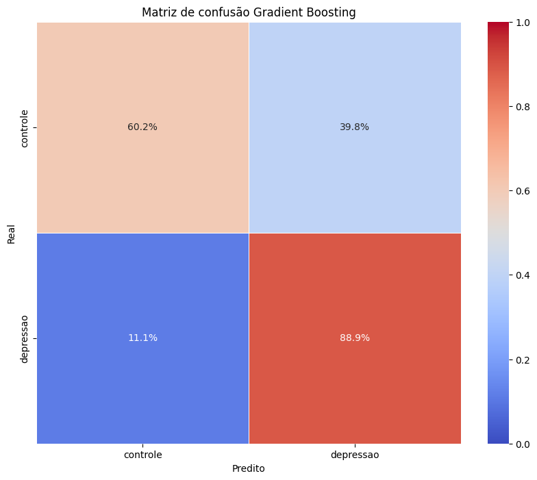 |  |
|  | 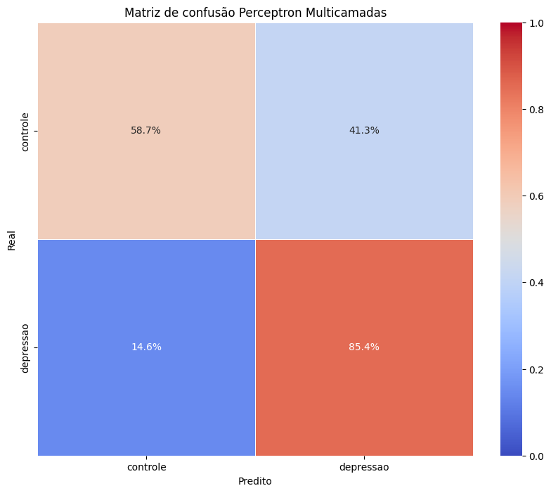 |

- **Resultados de teste próximos aos de validação** (queda de ~0,6–1,6 p.p. de F1), sem sinal de *overfitting* à validação.
- **Assimetria entre classes** (matrizes de confusão, monografia Fig. 4.9): acerto de **88–89%** na classe *depressão* contra **57–61%** na classe *controle*. O modelo tende a rotular como depressivo; **a taxa de falsos positivos é alta (39–43% dos controles)**.
- **Comparação com a literatura:** De Choudhury et al. relatam F1 médio ≈ 68,0% (inglês, dados de 2013). Não é uma comparação controlada: idioma, plataforma, época, rótulos e protocolo diferem.

### 4. Pandemia

- Autodeclarações de depressão na pandemia foram **mais que o dobro** das da pré-pandemia (ex.: "minha depressão" ≈ 37 mil e "tenho depressão" ≈ 21 mil ocorrências no período pré-pandemia).
- 116 usuários *controle* na pré-pandemia tornaram-se *depressão* na pandemia; 66 fizeram o caminho inverso.
- **Os autores não encontraram evidência estatística** de que a COVID-19 tenha aumentado os casos de depressão: a contagem de frases de autodeclaração depende do volume de tweets e do perfil da amostra, e não houve controle de variáveis de confusão.
- Nuvens de palavras de ambos os grupos têm "Deus" e "vida" entre os termos mais frequentes.

| | Pré-pandemia | Pandemia |
|---|---|---|
| Autodeclarações mais frequentes | 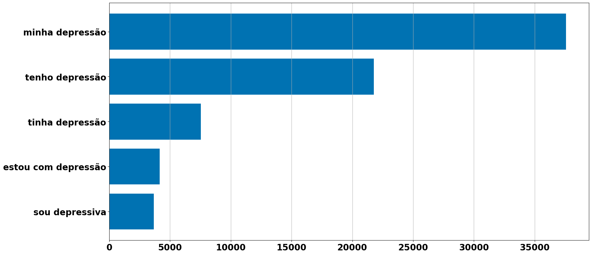 | 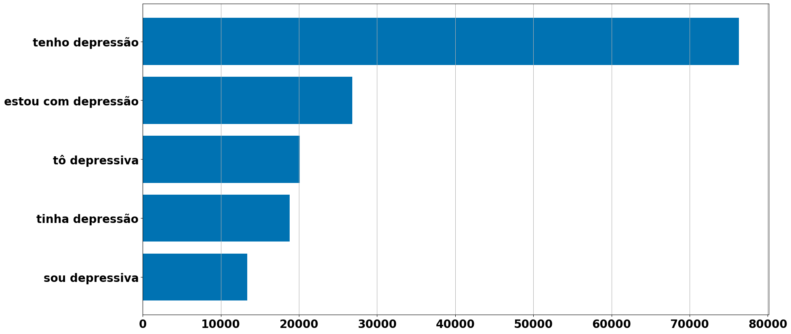 |
| Usuários que mudaram de classe | 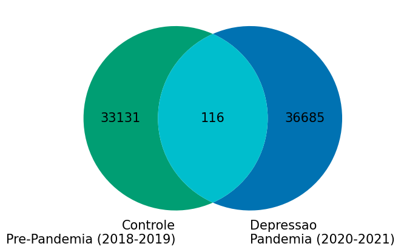 | 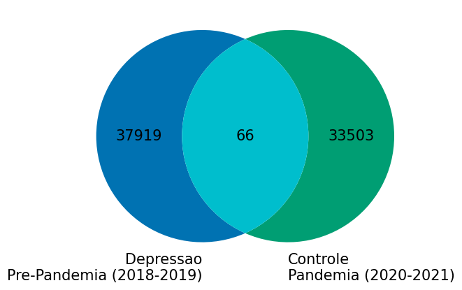 |
| Nuvem de palavras | 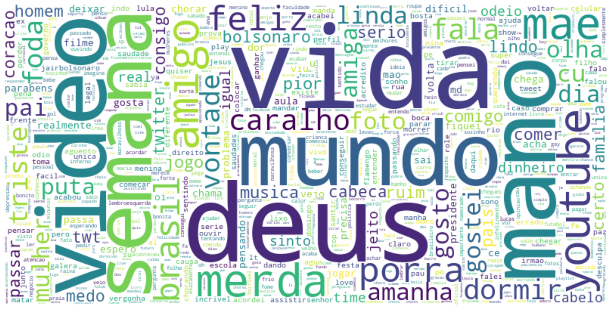 | 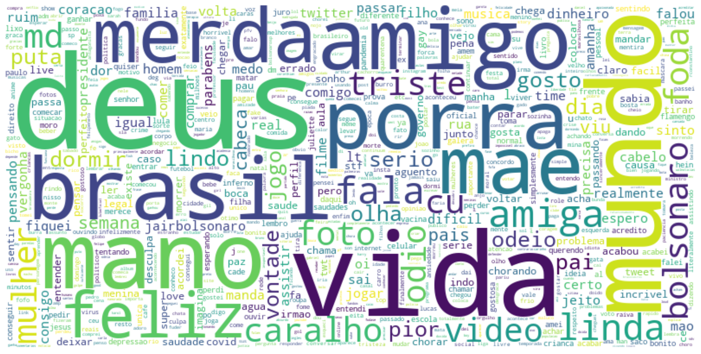 |
| Top palavras | 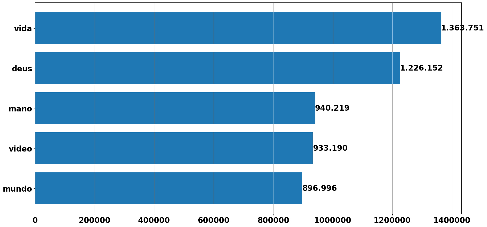 | 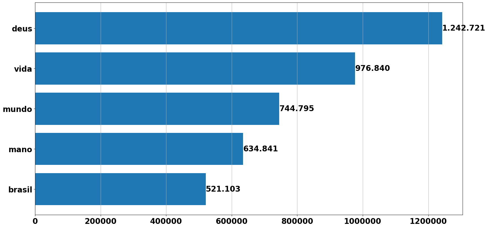 |

### Fontes dos números

Os números acima vêm das tabelas do [artigo](3430-Texto%20do%20artigo-22196-1-10-20240829.pdf) e da [monografia](2022_LuanMendesGoncalvesFreitas.pdf).

## 🔁 Reproduzir

> O pipeline original foi escrito para Python 3 com `tweepy==3.10.0` e `snscrape`. **A coleta de tweets depende de acesso ao Twitter/X, hoje restrito** — as etapas 1–2 provavelmente não reproduzem; use as bases já geradas em [datasets/](datasets/) para as etapas seguintes.

```bash
git clone https://github.com/luanfreitas5/UnBSense.git
cd UnBSense
pip install -r requirements.txt
```

Etapas (`python main.py -m <modo>`):

| # | Modo | Descrição |
|---|---|---|
| 1 | `buscar` | Busca usuários depressivos e de controle (multi-thread) |
| 2 | `coletar` | Coleta tweets dos usuários (multi-thread, demorado) |
| 3 | `mesclar` | Mescla os arquivos de tweets |
| 4 | `limpar` | Preparação dos textos |
| 5 | `atributos` | Extração dos 15 atributos |
| 6 | `qualidade` | Remoção de *outliers* |
| 7 | `vetores` | Vetores de características (média, variância, média móvel, entropia) |
| 8 | `dataset` | Criação das bases de dados |
| 9 | `apredizagem` | Treino e avaliação dos modelos (nome do modo como está em `main.py`) |
| 10 | `exploracao` | Gráficos de exploração de dados |
| 11 | `basetexto` → `frequencia` → `nuvempalavras` | Base de textos, frequência de palavras e nuvem de palavras |

Notebooks de modelagem em [aprendizagemMaquina/](aprendizagemMaquina/) (`pre_pandemia*.ipynb`, `pandemia*.ipynb`).

## 🧱 Estrutura

```
UnBSense/
├── main.py                      # orquestra as etapas via -m <modo>
├── pipeline/                    # etapas 1–6: busca, coleta, atributos, qualidade, vetores
├── snscrapeApp/                 # coleta no Twitter
├── processamentoLinguagemNatural/  # pré-processamento e nuvem de palavras
├── aprendizagemMaquina/         # seleção de atributos/modelos e notebooks
├── metodologia/                 # modelagem da metodologia
├── datasets/                    # bases pré-pandemia e pandemia + léxicos
└── docs/                        # documentação HTML gerada
```

## ⚠️ Limitações

- **Sem incerteza:** F1 de ponto único, sem IC, sem teste de significância entre modelos nem entre configurações de atributos.
- **Rótulo ruidoso:** autodeclaração pública no Twitter ≠ diagnóstico clínico; o controle pode conter pessoas com depressão não declarada. O modelo detecta "sinais de padrão de quem se autodeclara", e não depressão.
- **Muitos falsos positivos:** 39–43% dos controles classificados como depressivos; não use como triagem sem validação clínica.
- **Possível vazamento de rótulo:** não há evidência de que as próprias frases de autodeclaração foram excluídas dos textos usados nos atributos de linguagem (valência, termos depressivos); isso deve ser verificado.
- **Seleção de atributos antes do split** não está documentada; se feita nos dados completos, pode inflar o desempenho.
- **Sem análise por subgrupos** (região, idade, gênero) nem auditoria de *fairness*; sem Model Card e sem Datasheet.
- **Reprodutibilidade:** dependências sem versão (exceto `tweepy`), sem lockfile, sem testes automatizados; coleta via `snscrape`/Twitter provavelmente quebrada.
- **Privacidade (LGPD):** dados públicos e anonimizados, sem contato com usuários; ainda assim, o uso para inferir saúde mental exige cuidado ético (ver Cap. 5 da monografia).
- **Trabalhos futuros apontados:** RNN/LSTM, Transformers, TF-IDF, outros transtornos e outras redes sociais.

## 📄 Licença e citação

GPL-3.0 — ver [LICENSE](LICENSE).

```bibtex
@article{freitas_desenvolvimento_2024,
  title   = {Desenvolvimento de Ferramenta de Análise de Sentimentos para Identificação de Possíveis Sinais de Comportamento Depressivo na Rede Social Twitter},
  author  = {Freitas, Luan Mendes Gonçalves and Ladeira, Marcelo and Caetano, Marcos Fagundes},
  journal = {Revista Eletrônica de Iniciação Científica em Computação},
  volume  = {22},
  pages   = {91--100},
  year    = {2024},
  doi     = {10.5753/reic.2024.3430}
}

@mastersthesis{freitas_abordagem_2022,
  title  = {Abordagem baseada em aprendizagem de máquina para identificar sinais comportamento de depressão na rede social Twitter utilizando conteúdos das postagens e atividades},
  author = {Freitas, Luan Mendes Gonçalves},
  school = {Universidade de Brasília},
  year   = {2022},
  url    = {https://bdm.unb.br/handle/10483/33530}
}
```

## 🙏 Agradecimentos

Programa de Iniciação Científica 2021-2022 da UnB e CNPq. Versão inicial do pipeline: Otto von Sperling. Orientação: Marcelo Ladeira e Marcos Fagundes Caetano.
